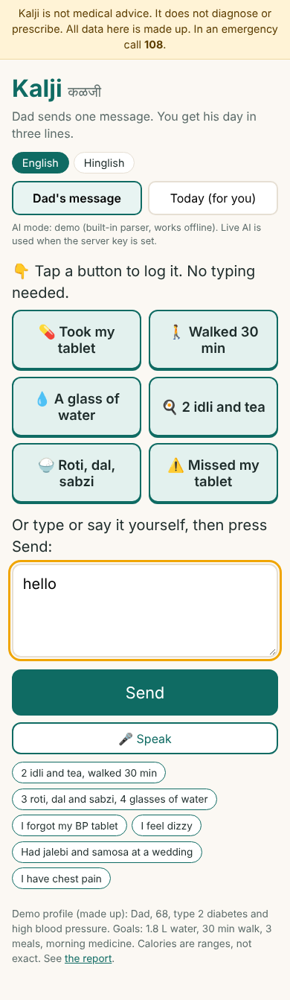
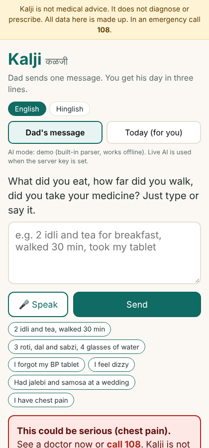
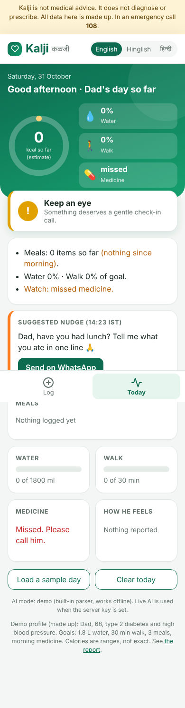
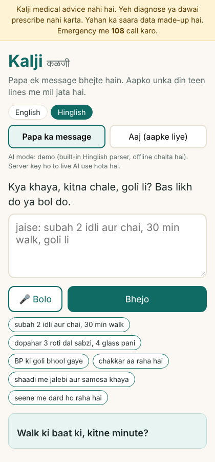

# Report: Kalji

**Yash Parulekar · Roll No. PGDMAI-25-16**

## Q1. Why do health apps fail?

> **Status: published sources found; reviews and interviews still to be added by the student (see the evidence tables below).**

### Published sources (found by web search; open each link and check the figures before submitting)
- **Kidman et al. (2024), "When and Why Adults Abandon Lifestyle Behavior and Mental Health Mobile Apps: Scoping Review", *Journal of Medical Internet Research* 26, e56897** (https://www.jmir.org/2024/1/e56897). Reported: a median of about 70% of users stop within 100 days; abandonment is fastest soon after download; most studies report attrition rates without examining why.
- **Industry data cited in the same review:** about 66% of health apps and 69% of fitness apps are abandoned within 90 days (commercial figures, not peer-reviewed).
- **Schroé et al. (2022), MyPlan 2.0 physical-activity intervention:** 227 of 473 participants (47.9%) stopped using it, mostly at the start; authors recommend minimal early questionnaires.
- **Vaghefi & Tulu (2019):** users judge an app's usefulness and their own persistence toward the goal, then abandon, limit, switch or continue.
- **Droid Life (24 Aug 2022), "MyFitnessPal puts barcode scanner behind premium paywall"** (https://www.droid-life.com/2022/08/24/myfitnesspal-puts-barcode-scanner-behind-premium-paywall/): a free feature moved behind a subscription from 1 Oct 2022.

### Review evidence: 30 one- and two-star reviews, 3 apps

**How collected, and its limits.** Reviews were gathered with an AI assistant from public Google Play archives (Chrome-Stats, AppBrain) and Trustpilot, 10 per app (links in References). The assistant gave **paraphrased summaries, not verbatim quotes**; I have not been able to confirm each one against the original page. [STUDENT: open the Chrome-Stats links, check at least 5 reviews per app and replace their summaries with exact quotes.] These are selected negative reviews, not a representative sample, and reviewers' ages are unknown. Each review can carry up to three tags, so counts add up to more than 30.

| # | App | ★ | Date | What the reviewer said (paraphrased) | Tags |
|---|---|---|---|---|---|
| 1 | HealthifyMe | 1 | 15 Oct 2026 | Pressured to buy a subscription; unsatisfactory exchange with a representative | Pay, Sup |
| 2 | HealthifyMe | 1 | 15 Oct 2026 | Diet suggestions repetitive and unappealing; the AI did not adapt when given instructions | Gen |
| 3 | HealthifyMe | 2 | 15 Oct 2026 | Calorie tracking inaccurate even for packaged foods; hard to correct entries | Acc, Fric |
| 4 | HealthifyMe | 1 | 15 Oct 2026 | Paid programme lacked personalised measurements and guidance; unhappy with refund offered | Gen, Sup |
| 5 | HealthifyMe | 1 | 14 Oct 2026 | Coaching follow-ups stopped, diet plan not delivered, refund less than expected | Sup |
| 6 | HealthifyMe | 1 | 12 Oct 2026 | Paid AI assistant could not follow the user's existing diet plan; kept repeating unsuitable foods | Gen |
| 7 | HealthifyMe | 1 | 8 Oct 2026 | App slow; food-photo tracking did not work | Tech, Acc |
| 8 | HealthifyMe | 1 | 25 Sep 2026 | Technical problems blocked promised services after payment | Tech, Pay |
| 9 | HealthifyMe | 1 | 25 Sep 2026 | Meal plans generic; refund hard to get | Gen, Sup |
| 10 | HealthifyMe | 1 | 25 Aug 2026 | Unhappy with premium diet plan; refund support unresponsive | Pay, Sup |
| 11 | MyFitnessPal | 1 | 16 Oct 2026 | New interface needs too many taps; simple daily meal/macro overview gone | Fric |
| 12 | MyFitnessPal | 2 | 16 Oct 2026 | After update, per-meal protein/carb/fat totals no longer visible without opening entries | Fric |
| 13 | MyFitnessPal | 1 | 15 Oct 2026 | Long-term user: logging, copying meals and checking nutrition got harder | Fric |
| 14 | MyFitnessPal | 1 | 15 Oct 2026 | Barcode scanning should not need a paid subscription | Pay |
| 15 | MyFitnessPal | 1 | 15 Oct 2026 | Update moved previously free features behind a paywall; considering alternatives | Pay |
| 16 | MyFitnessPal | 1 | 15 Oct 2026 | Removal of per-meal macro summaries made it less useful for goals | Fric |
| 17 | MyFitnessPal | 1 | 15 Oct 2026 | Found notifications distressing and inappropriate | Notif |
| 18 | MyFitnessPal | 1 | 15 Oct 2026 | Redesign made copying previous meals complicated; nutrition info removed from main screen | Fric |
| 19 | MyFitnessPal | 1 | 15 Oct 2026 | Setup errors; objected to barcode scanning being paid-only | Pay, Tech |
| 20 | MyFitnessPal | 1 | 19 Oct 2026 | After ~10 years switched to Cronometer: unpopular redesign, dissatisfied with company's response to feedback | Fric, Sup |
| 21 | Fitbit | 1 | 10 Oct 2026 | Excessive monitoring permissions and high battery use | Priv |
| 22 | Fitbit | 1 | 10 Oct 2026 | After update, exercise data stopped syncing to Lose It | Tech |
| 23 | Fitbit | 1 | 10 Oct 2026 | Frequent disconnections; new limits on connecting other apps | Tech |
| 24 | Fitbit | 1 | 10 Oct 2026 | Steps miscounted during workouts; support could not fix it | Acc, Sup |
| 25 | Fitbit | 1 | 10 Oct 2026 | Nutrition tracking described as inadequate | Acc |
| 26 | Fitbit | 1 | 10 Oct 2026 | App repeatedly lost connection to device; considering Garmin | Tech |
| 27 | Fitbit | 1 | 10 Oct 2026 | Redesign made editing activities hard; lost previous statistics | Fric |
| 28 | Fitbit | 1 | 18 Sep 2026 | Charge 6: sync failures, missing sleep data, less intuitive interface | Tech, Fric |
| 29 | Fitbit | 1 | 23 Sep 2026 | Unreliable step counts, silent-alarm sync problems, unnecessary complexity in new app | Acc, Tech, Fric |
| 30 | Fitbit | 1 | 23 Sep 2026 | Updated sleep tracking inaccurate; doubts about usefulness of sleep scores | Acc |

**Tag counts (reviews mentioning each theme, out of 30)**

| Theme | Tag | Reviews | Share |
|---|---|---|---|
| Does not work or cannot be trusted (bugs, sync, wrong numbers) | Tech + Acc | 12 | 40% |
| Paid, got little, nobody helped (paywall, refunds, support) | Pay + Sup | 11 | 37% |
| Simple daily use got harder (redesign, extra taps, removed views) | Fric | 10 | 33% |
| Generic plan, or the AI did not adapt | Gen | 4 | 13% |
| Notifications | Notif | 1 | 3% |
| Privacy / battery | Priv | 1 | 3% |
| Too many ads | (none) | 0 | 0% |

**Class guesses tested against these reviews**
- **H1 Too complex:** *partly.* The complaint is not "too many features" but that simple things (copy a meal, see a daily total) became harder after updates (10 of 30).
- **H2 Too expensive:** *reframed.* The pain is paying and getting little back (generic plans, missing coaching, hard refunds), and features moving behind a paywall (11 of 30). Price alone is rarely the complaint.
- **H3 Too many ads:** *not supported.* 0 of 30.
- **H4 Too wordy:** *not tested by these reviews* (0 mentions); keep it as a design rule for our own app.
- **New finding:** 4 reviews on HealthifyMe say its AI/diet plan was generic or ignored instructions. AI that does not adapt is itself a reason to quit, which matters for Q3.
- **Gap in this evidence:** nobody says "I forgot" or "I lost motivation". Low-star reviewers are people still engaged enough to complain, so the quiet majority who simply drift away are missing. The interviews below must cover this.

### Interviews with people who stopped using a health app

*Ten short interviews (7 by WhatsApp, 3 in person), 29-31 Oct 2026, with people in Goa who had used a health app and stopped. Same four questions each time. First names only; answers lightly trimmed, in the person's words.*

| # | Who | App, how long | Last opened | Why they stopped | What would have kept them | Tags |
|---|---|---|---|---|---|---|
| 1 | Prathamesh, 25, Panaji (WhatsApp, 31 Oct 2026) | HealthifyMe, about 6 months | about 2 months ago | "It became tiring to enter everything I ate. Sometimes I couldn't find the exact homemade food in the app, so I slowly stopped using it." | "If I could just send a photo of my food and get an approximate calorie count, I would have continued." | Eff, Cov |
| 2 | Nandini, 23, Margao (WhatsApp, 31 Oct 2026) | MyFitnessPal, about 4 months | about 3 months ago | "I kept forgetting to update my meals, and entering every ingredient was too much work. Eventually, I lost interest." | "Something simpler where I could just type what I ate and get an approximate calorie count without entering every ingredient." | Eff, Pull |
| 3 | Vishal, 29, Mapusa (in person, 30 Oct 2026) | Fitbit, almost a year | about 4 months ago | "My routine changed because of work, and I stopped wearing my fitness tracker regularly. After that, I didn't see much point in opening the app." | "If it gave me useful fitness updates without depending so much on the watch, I might have continued." | Pull |
| 4 | Jose, 27, Vasco da Gama (WhatsApp, 31 Oct 2026) | Cult.fit, about 5 months | about 2 months ago | "Initially, I followed the workouts regularly, but later my work timings changed. I couldn't maintain the routine, and I didn't feel the subscription was worth it." | "Shorter workouts that I could do whenever I had free time, without paying for an expensive subscription." | Pull, Pay |
| 5 | Arnav (21), 21, Ponda (WhatsApp, 31 Oct 2026) | Google Fit, about 8 months | about a month ago | "I wasn't getting much useful information apart from my step count. After some time, I didn't feel the need to check it every day." | "Better personalised fitness suggestions and simple daily goals based on my activity." | Pull, Val |
| 6 | Mangirish, 26, Porvorim (in person, 30 Oct 2026) | MyFitnessPal, almost 7 months | about 6 weeks ago | "Tracking protein and calories every single day became irritating. I was eating almost the same meals regularly, but still had to keep updating everything." | "If it automatically remembered my regular meals and made tracking easier, I would have continued." | Eff |
| 7 | Sunil, 52, Candolim (in person, 29 Oct 2026) | Google Fit, about 5 months | about 3 months ago | "I found it unnecessary to keep checking an app just to know how much I walked. I also didn't understand some of the information it displayed." | "A simple daily message telling me how much I walked and whether I reached my goal would have been enough." | Pull, Val |
| 8 | Shreyash, 24, Calangute (WhatsApp, 31 Oct 2026) | HealthifyMe, about 3 months | almost 2 months ago | "I wanted basic calorie tracking, but the app kept showing premium features and subscription options. I didn't want to pay just to track my meals." | "Free basic calorie tracking, fewer advertisements and a simpler interface." | Pay |
| 9 | Shravan, 30, Bicholim (WhatsApp, 30 Oct 2026) | Fitbit, about 2 years | about 5 months ago | "The syncing was giving me problems, and sometimes my sleep data wasn't recorded properly. Eventually, I stopped wearing the tracker." | "More accurate tracking, fewer syncing issues and a simpler way to check my daily fitness progress." | Acc |
| 10 | Arnav (22), 22, Margao (WhatsApp, 31 Oct 2026) | HealthifyMe, about 4 months | about a month ago | "I wasn't able to track homemade food properly, and constantly searching for food items took too much time." | "If I could just message what I ate and get an estimated calorie and protein count, it would be much more convenient." | Eff, Cov |

**Tags:** Eff = daily effort of logging; Cov = food not found or wrong (homemade Indian food); Pull = nothing pulled them back once their routine changed or interest faded; Pay = subscription not worth it; Val = the app told them little of use; Acc = unreliable sync or data.

| Theme | Interviews | Of 10 |
|---|---|---|
| Nothing pulled them back (routine changed, forgot, "no point opening it") | 2, 3, 4, 5, 7 | 5 |
| Daily effort of logging | 1, 2, 6, 10 | 4 |
| Food not found / wrong (homemade Indian) | 1, 10 | 2 |
| Subscription not worth it | 4, 8 | 2 |
| Told them little of use | 5, 7 | 2 |
| Unreliable sync / data | 9 | 1 |

**What they said would keep them:** send or type what they ate and get an approximate number (1, 2, 10; three of the four who quit calorie logging); have regular meals remembered (6); one simple daily message (7); simple goals and personal suggestions (5); not needing a watch (3); free basics or short, cheaper options (4, 8); fewer sync problems (9).

**What the interviews add to the reviews.**
- Reviews come from people still engaged enough to complain. The interviews show the quiet quitters: half simply drifted away when life changed and nothing brought them back. No review mentions this.
- Logging was not one bad experience but a daily cost until it was not worth paying ("it became tiring", "irritating", "too much work").
- Three of the four calorie-logging quitters independently asked for the same thing: just tell the app what I ate and get an approximate answer.
- Interview 7 (Sunil, 52) is the only older user. He wanted one simple daily message rather than checking an app.
- **Limit:** nine of the ten are 21-30, are in Goa, and quit apps for themselves. None is looking after a parent. These interviews do not directly show what a carer wants.

**My three most important reasons, ranked** (reviews and interviews combined, 40 sources: 30 reviews + 10 interviews; the top three are close, so read them as a group):

1. **The numbers cannot be trusted or do not fit the person's food** (15 of 40, 38%): 12 reviews (sync failures, wrong calories even for packaged food, miscounted steps, failed photo logging), plus interview 9 (sync and sleep data) and interviews 1 and 10 (homemade Indian food not in the app). Consistent with Kidman et al. (2024), where technical problems are among the reasons people leave.
2. **Daily use is too much effort** (14 of 40, 35%): 10 reviews (redesigns that add taps and remove the simple daily view, difficult editing), plus interviews 1, 2, 6 and 10 ("it became tiring to enter everything I ate", "entering every ingredient was too much work", "I was eating almost the same meals regularly, but still had to keep updating everything"). Kidman et al. also found abandonment is fastest early, when effort is highest.
3. **Paying does not feel worth it** (13 of 40, 33%): 11 reviews (pressure to subscribe, generic paid plans, coaching that stopped, refunds hard to get, free features moved behind a paywall; Droid Life, 2022), plus interviews 4 and 8 ("I didn't want to pay just to track my meals").

**A reason that goes beyond the obvious: nothing pulls people back.** Five of the ten interviewees (2, 3, 4, 5, 7) quit not because the app failed but because their routine changed or interest faded and nothing brought them back ("I didn't see much point in opening the app"). It does not appear in the 30 reviews, because those reviewers were still engaged enough to complain. It is the main reason among quiet quitters, who reviews miss, and the one no existing app fixes: apps wait to be opened. I treat it as a fourth reason that shapes the design, even though its raw count is lower.

**The class guesses against all the evidence:** H1 too complex: partly (simple things got harder; 1 interviewee wanted a "simpler interface"). H2 too expensive: reframed as "not worth paying" (13 of 40). H3 too many ads: almost none (1 of 40). H4 too wordy: not shown by any review or interview, so it stays a design rule for our own app. New: AI that does not adapt is itself a reason to quit (4 HealthifyMe reviews).

## Q2. Who exactly is your customer?

**Customer:** a working adult in their late 20s to 40s, living and working away from home (or simply busy all day), whose parent aged 60+ lives alone or mostly alone in Goa. The parent has a long-term condition such as type 2 diabetes or high blood pressure, uses WhatsApp every day, and does not use health apps.

**Composite persona (an illustration built from the evidence, not a real person or interviewee):** "Meera", 31, a software tester in Pune. Her father, 68, lives alone in Mapusa with type 2 diabetes and high blood pressure. She calls every evening, and he says "sab theek". She wants to know whether he ate, walked and took his tablet, without turning the call into an inspection.
*[STUDENT: if you interview a real carer, replace "Meera" with them, with their permission.]*

**What they are trying to get done:** know, without nagging, whether the parent ate properly, walked, took the medicine and feels fine, and be told early if something is wrong.

**What they have tried, and why it did not work:**
- *Phone calls:* the parent says "sab theek", and the call itself becomes a chore on both sides.
- *A calorie-counting app:* the parent will not type every meal. Interviews 1, 2, 6 and 10 describe exactly this cost of daily logging, even for young, willing users.
- *A smartwatch or tracker:* interview 3 stopped wearing his, and interview 9 gave up on sync problems; an older parent is less likely to wear one at all.

**Customers I considered and rejected:**
- *Young people (15-30) tracking their own fitness.* Q1 shows this group quits for the reasons above, and it is the best-evidenced group (nine of my ten interviews). I rejected it because it is the most crowded market (HealthifyMe, MyFitnessPal, Fitbit all target it), churn is the norm, and under-25s have limited ability to pay (class notes). Our answer to "just tell it what you ate" is real but not unique to a younger person, so a carer-focused product has a clearer gap.
- *Adults over 60 using the app themselves.* The need is real, but they rarely install or maintain apps, and Interview 7 (52) did not want to open an app at all, only to receive "a simple daily message". The adult child is the one who worries and will look at a screen.
- *Gym-goers counting protein* (interview 6): well served by existing apps, and the product would compete on features, which this project deliberately avoids.

**How this choice follows from Q1** (and where it does not):
- *Daily effort is a top reason to quit* (14 of 40). A parent will not log meals, so the design removes logging: one short message in English or Hinglish, and the AI structures it.
- *Nothing pulls people back* (5 of 10 interviews). Apps wait to be opened. In Kalji the **child** gets a proactive nudge ("Dad, did you take your tablet today?") to send, so the habit is held by the person who cares, not by an app notification the parent ignores.
- *Numbers cannot be trusted* (15 of 40). So Kalji shows calorie **ranges**, asks one question instead of guessing, and never reports "all fine" when data is missing.
- *Paying does not feel worth it* (13 of 40). No paywall in the prototype; value comes first.
- *Interview 7 (Sunil, 52)* asked for exactly the output: "a simple daily message telling me how much I walked and whether I reached my goal".
- **The gap:** none of my ten interviewees was a carer, so Q1 supports the *mechanisms* (low effort, proactive nudges, ranges, simple output) but not directly the *customer's* need. [STUDENT: close this gap with the two questions below and report the answers; if you cannot, leave this sentence in, because it is accurate.]

**Carer interviews** *(to add)*: [STUDENT: ask 2 people who worry about a parent's health: "How do you find out how your parent is doing day to day? What would make that easier?" and "Would you use an app where your parent just sends a WhatsApp-style message and you get a short daily summary? What worries you about it?" Paste their answers, with first name, age and city.]

## Q3. What does AI do in my app that ordinary software could not?

**Decides:** which food, quantity, water, walk, medicine status and symptoms are in a free-form Hinglish message; when a message is too vague (it asks one question instead of guessing); what the child should be nudged about next.
**Does on its own:** turns messy text/voice into structured entries; estimates calorie *ranges*; builds a 3-line summary; drafts the WhatsApp nudge by time of day (IST).
**Must never:** diagnose, advise on medicine or doses, report a calorie number as exact, say "all fine" when data is missing, or let a model decide whether something is an emergency. Red-flag detection is a fixed rule set, so a model failure or hallucination cannot suppress it; the live model may only *add* to it.

**How it is built:** the default engine is a deterministic Hinglish parser (`parser.js`) so the app always works with no key. An optional server endpoint (`api/parse.js`) sends the same message to a Claude model with a strict JSON schema; its output is validated and clamped, and the rule-based red-flag check is merged on top.

**Test results** (run with `npm test`; **demo-mode parser**. Live-model results: [ADD after you set a key and run the same 10 inputs, or state that live AI was not tested]):

| # | Input | What the AI did | Good enough? |
|---|---|---|---|
| 1 | aaj nashta me 2 idli aur chai li, sugar wali | Idli×2 (80-120 kcal), chai (flagged "has sugar?") | Yes. Did not use the "sugar wali" hint to raise chai's estimate. |
| 2 | dopahar ko 3 roti, dal, sabzi aur thoda chawal khaya | Roti×3, dal, sabzi, rice (1 katori default) | Yes, but "thoda" (a little) ignored, so rice is overestimated. |
| 3 | subah 30 min walk kiya, 4 glass pani piya | Walk 30 min, water 1000 ml | Yes |
| 4 | BP ki goli bhool gaye aaj | Medicine: missed | Yes. Child sees "Missed. Please call him." |
| 5 | papa ko chakkar aa raha hai aur kamzori hai | Symptoms: dizziness, weakness; listed under "Watch" | Yes. No diagnosis offered. |
| 6 | seene me dard ho raha hai | Red alert: chest pain → "see a doctor / call 108"; child summary leads with it | Yes |
| 7 | jalebi aur samosa khaya shaadi me | Sweet (flag: high sugar) + fried snack, ranges only | Yes |
| 8 | rice khaya nahi, sirf dahi aur kela | Curd, banana; rice excluded | Yes **after a fix**: first run counted rice as eaten (negation after the food word). Fixed at clause level. |
| 9 | thoda ghumne gaye the | Asks "how many minutes?" instead of guessing | Yes |
| 10 | aaj kuch khaya, thali jaisa tha, bahut tasty | Asks "what was it?" | Yes. Does not invent calories. |

**Language.** The app opens in English; a toggle switches the whole interface, confirmations, alerts and nudges to Hinglish. The parser understands both English and Hinglish input. I added 6 English cases (11-16 in `tests/cases.js`, all passing). Writing them exposed two more bugs that also affected Hinglish, which I fixed: "3 roti, dal" gave dal ×3 (quantity leaked across a comma), and "4 glasses of water" counted 2000 ml (the letter "l" in "dal" was read as a litre unit).

> **Add your own failures here.** Only 10 cases written by me, who also wrote the parser, so they are friendly. Before submitting, try 5-10 nastier messages (Marathi/Konkani words, "thoda sa", typos, a photo of a thali) and add the failures honestly. Known gaps: no photo input, a limited food list, quantity words like "thoda/aadha katori" mostly ignored, Marathi/Konkani vocabulary not covered.

## Q4. What I will build, and what I will leave out

| ID | Feature | Build now / Later / Never | Reason |
|---|---|---|---|
| F01 | Food photo to calories | Later | Single-photo calorie estimates are unreliable for mixed Indian plates (D06, D11); text/voice covers the need with ranges. |
| F02 | Profile and goals | Build now (minimal) | Only fixed goals for one made-up parent. No BMI, no reference image. |
| F03 | Activity tracking | Build now (minimal) | Walk minutes from the message; no sensors needed. |
| F04 | Diet plan | Never | Prescribing a calorie-deficit plan for a diabetic parent is medical territory. |
| F05 | Progress tracker | Build now | The daily summary and bars. Fasting tracker and product upsell: Never (conflict of interest; supplements). |
| F06 | Sleep tracking | Later | Needs a device or reliable self-report; not core. |
| F07 | Challenges and motivation | Never | Streak/challenge mechanics are what churn-prone apps do; our user is a parent, not a gamer. |
| F08 | AI health coach | Never (as a chatbot) | Replaced by the proactive message-to-summary flow; open-ended health chat raises the diagnosis risk. |
| F09 | Catch-up planning | Later | Valuable once there is a plan; we do not prescribe plans yet. The nudge is the light version. |
| F10 | Reports | Later | The daily summary is the report; weekly export once data exists. |
| F11 | Wearables | Never (for now) | The target parent will not wear one (D05). |
| F12 | Subscription tiers | Later | Prove usefulness first. |
| F13 | Free consultation | Never | Needs doctors and compliance; out of scope. |
| F14 | Community activities | Never | Not core to this customer. |
| F15 | Emergency: hospital | Never (integration) | We only show "call 108" on red flags. We cannot guarantee a hospital connection. |
| F16 | Emergency: caretaker or nurse | Later | Natural extension of the child's view. |
| F17 | Guardian access | Build now (reframed) | This *is* the product: the child's "Today" view. |
| F18 | Friends groups | Never | Public comparison does not suit a 68-year-old with a health condition. |
| N01 | Hinglish message-to-structure (voice or text) | Build now | The AI core: replaces the logging form. |
| N02 | Proactive nudge draft | Build now | Time-of-day check-in message for the child to send. |
| N03 | Red-flag rule layer | Build now | Safety that does not depend on a model. |

**The core experience.** *First two minutes:* open the link → Papa's tab: one big box, a mic and example chips → type or say "2 idli aur chai, 30 min walk" → instant "Likh liya ✔" confirmation, or a single question if something is unclear. The child opens "Today": a three-line summary, bars and a suggested nudge. *Normal day:* Papa sends 2-3 lines; the child glances at the summary once in the evening and sends a suggested nudge when something is missing.

Screenshots (English and Hinglish):    

**My three hardest calls:** *(my draft reasoning; edit it into your own words and check it against your research)*
1. **Text/voice message vs. food photo first.** Weighed: the photo demo is impressive, but accuracy on thalis is poor and a wrong number on a diabetic's diet erodes trust. Chose: message first, calorie *ranges*, photo later. *Would change my mind if:* testers say typing is the barrier, or a photo test shows ≤25% error on common dishes.
2. **Cut the AI coach chatbot.** Weighed: it is the class's flagship feature. Chose: no open chat; the AI works on input and summaries only, limiting diagnosis risk and wordiness (H4). *Would change my mind if:* users repeatedly ask follow-up questions the app cannot answer.
3. **Rule-based safety instead of model-based.** Weighed: a model understands more phrasing. Chose: fixed rules that a model can only add to, because a missed red flag costs far more than a false alarm. *Would change my mind if:* testing shows many false alarms that make users ignore alerts.

## Q5. User test

> **TODO (you must do this):** show the live link to at least one adult-child of a parent 60+ (a classmate or family friend who fits). Watch without helping. Record: who, what they did, where they hesitated, what you changed (even a small copy or button fix), with a commit link.

**Who tested it, what they did, what confused them, and what I changed:** [ ]

## References

1. Kidman et al. (2024), JMIR 26, e56897: https://www.jmir.org/2024/1/e56897
2. Droid Life (2022), MyFitnessPal barcode scanner paywall: https://www.droid-life.com/2022/08/24/myfitnesspal-puts-barcode-scanner-behind-premium-paywall/
3. Chrome-Stats, Google Play review archives for HealthifyMe, MyFitnessPal and Fitbit: https://chrome-stats.com/d/com.healthifyme.basic/reviews , https://chrome-stats.com/d/com.myfitnesspal.android/reviews , https://chrome-stats.com/d/com.fitbit.FitbitMobile/reviews
4. Trustpilot, HealthifyMe and MyFitnessPal review pages: https://www.trustpilot.com/review/www.healthifyme.com , https://www.trustpilot.com/review/www.myfitnesspal.com
5. AppBrain, Fitbit Google Play reviews (as listed by the assistant).
2. Anthropic API documentation (https://docs.anthropic.com), used for the optional live endpoint.
3. Class Discussion Notes: Health AI App, MAI-594 (2026).

---

## Student declaration

1. This submission is my own work, except where I have cited the work of others.
2. I have not submitted this work, in whole or in part, for assessment in any other course.
3. I have used generative AI tools only as permitted by the project brief, and I have disclosed that use below.

**Name:** Yash Parulekar · **Roll No.:** PGDMAI-25-16 · **Date:** 31 October 2026

**AI-use disclosure**

| Tool used | What it was used for | How I checked its output |
|---|---|---|
| ChatGPT (or similar assistant) | Gathered and paraphrased the 30 low-star reviews in Q1 | Not yet independently checked: [STUDENT: spot-check reviews against Chrome-Stats and say so here] |
| Claude Code | Proposed the product direction, wrote the parser, UI, tests and the draft of this report | Ran the 10-case test suite; it found a negation bug that was fixed; viewed the app in a browser; red-flag path tested by hand. [Edit: say what *you* reviewed and changed.] |
