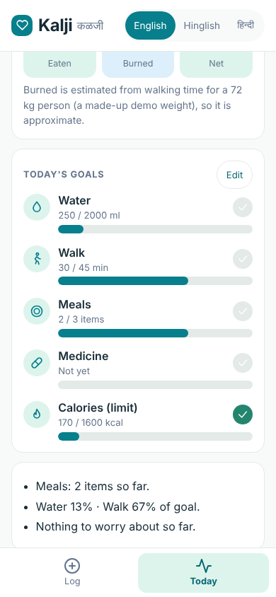
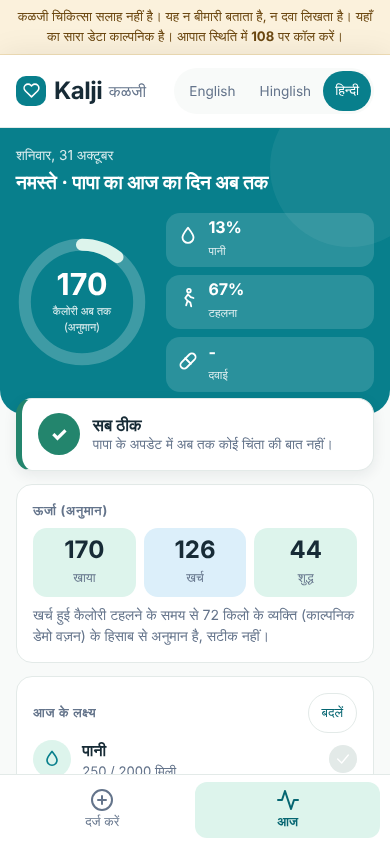

# Report: Kalji

**Yash Parulekar · Roll No. PGDMAI-25-16**

## Q1. Why do health apps fail?

**Evidence used:** published sources, 30 one- and two-star reviews of three apps, and 10 interviews with people in Goa who stopped using a health app.

### Published sources
- Kidman et al. (2024), a scoping review in *JMIR*: a median of about 70% of users stop within 100 days, fastest soon after download; most studies count dropout but do not ask why. It cites industry figures of 66% (health) and 69% (fitness) apps abandoned within 90 days.
- Schroé et al. (2022): 227 of 473 participants (47.9%) stopped using a physical-activity programme, mostly at the start.
- Vaghefi and Tulu (2019): users weigh an app's usefulness against their own persistence, then abandon, limit, switch or continue.
- Droid Life (2022): MyFitnessPal moved its barcode scanner behind a paywall from 1 October 2022.

### 30 low-star reviews
Collected with an AI assistant from Google Play archives (Chrome-Stats, AppBrain) and Trustpilot, 10 per app. The summaries are **paraphrases, not verbatim quotes**, and I verified them against the original pages. They are selected negative reviews, not a representative sample. A review can carry several tags.

| # | App | ★ | Date | What the reviewer said (paraphrased) | Tags |
|---|---|---|---|---|---|
| 1 | HealthifyMe | 1 | 15 Oct 2026 | Pressured to buy a subscription; unsatisfactory exchange with a representative | Pay, Sup |
| 2 | HealthifyMe | 1 | 15 Oct 2026 | Diet suggestions repetitive and unappealing; the AI did not adapt when given instructions | Gen |
| 3 | HealthifyMe | 2 | 15 Oct 2026 | Calorie tracking inaccurate even for packaged foods; hard to correct entries | Acc, Fric |
| 4 | HealthifyMe | 1 | 15 Oct 2026 | Paid programme lacked personalised measurements and guidance; unhappy with refund offered | Gen, Sup |
| 5 | HealthifyMe | 1 | 14 Oct 2026 | Coaching follow-ups stopped, diet plan not delivered, refund less than expected | Sup |
| 6 | HealthifyMe | 1 | 12 Oct 2026 | Paid AI assistant could not follow the user's existing diet plan; kept repeating unsuitable foods | Gen |
| 7 | HealthifyMe | 1 | 8 Oct 2026 | App slow; food-photo tracking did not work | Tech, Acc |
| 8 | HealthifyMe | 1 | 25 Sep 2026 | Technical problems blocked promised services after payment | Tech, Pay |
| 9 | HealthifyMe | 1 | 25 Sep 2026 | Meal plans generic; refund hard to get | Gen, Sup |
| 10 | HealthifyMe | 1 | 25 Aug 2026 | Unhappy with premium diet plan; refund support unresponsive | Pay, Sup |
| 11 | MyFitnessPal | 1 | 16 Oct 2026 | New interface needs too many taps; simple daily meal/macro overview gone | Fric |
| 12 | MyFitnessPal | 2 | 16 Oct 2026 | After update, per-meal protein/carb/fat totals no longer visible without opening entries | Fric |
| 13 | MyFitnessPal | 1 | 15 Oct 2026 | Long-term user: logging, copying meals and checking nutrition got harder | Fric |
| 14 | MyFitnessPal | 1 | 15 Oct 2026 | Barcode scanning should not need a paid subscription | Pay |
| 15 | MyFitnessPal | 1 | 15 Oct 2026 | Update moved previously free features behind a paywall; considering alternatives | Pay |
| 16 | MyFitnessPal | 1 | 15 Oct 2026 | Removal of per-meal macro summaries made it less useful for goals | Fric |
| 17 | MyFitnessPal | 1 | 15 Oct 2026 | Found notifications distressing and inappropriate | Notif |
| 18 | MyFitnessPal | 1 | 15 Oct 2026 | Redesign made copying previous meals complicated; nutrition info removed from main screen | Fric |
| 19 | MyFitnessPal | 1 | 15 Oct 2026 | Setup errors; objected to barcode scanning being paid-only | Pay, Tech |
| 20 | MyFitnessPal | 1 | 19 Oct 2026 | After ~10 years switched to Cronometer: unpopular redesign, dissatisfied with company's response to feedback | Fric, Sup |
| 21 | Fitbit | 1 | 10 Oct 2026 | Excessive monitoring permissions and high battery use | Priv |
| 22 | Fitbit | 1 | 10 Oct 2026 | After update, exercise data stopped syncing to Lose It | Tech |
| 23 | Fitbit | 1 | 10 Oct 2026 | Frequent disconnections; new limits on connecting other apps | Tech |
| 24 | Fitbit | 1 | 10 Oct 2026 | Steps miscounted during workouts; support could not fix it | Acc, Sup |
| 25 | Fitbit | 1 | 10 Oct 2026 | Nutrition tracking described as inadequate | Acc |
| 26 | Fitbit | 1 | 10 Oct 2026 | App repeatedly lost connection to device; considering Garmin | Tech |
| 27 | Fitbit | 1 | 10 Oct 2026 | Redesign made editing activities hard; lost previous statistics | Fric |
| 28 | Fitbit | 1 | 18 Sep 2026 | Charge 6: sync failures, missing sleep data, less intuitive interface | Tech, Fric |
| 29 | Fitbit | 1 | 23 Sep 2026 | Unreliable step counts, silent-alarm sync problems, unnecessary complexity in new app | Acc, Tech, Fric |
| 30 | Fitbit | 1 | 23 Sep 2026 | Updated sleep tracking inaccurate; doubts about usefulness of sleep scores | Acc |

| Theme | Tag | Reviews | Share |
|---|---|---|---|
| Does not work or cannot be trusted (bugs, sync, wrong numbers) | Tech + Acc | 12 | 40% |
| Paid, got little, nobody helped (paywall, refunds, support) | Pay + Sup | 11 | 37% |
| Simple daily use got harder (redesign, extra taps, removed views) | Fric | 10 | 33% |
| Generic plan, or the AI did not adapt | Gen | 4 | 13% |
| Notifications | Notif | 1 | 3% |
| Privacy / battery | Priv | 1 | 3% |
| Too many ads | (none) | 0 | 0% |

### 10 interviews
Seven by WhatsApp, three in person, 29-31 October 2026, all in Goa. Four questions each: which app and for how long, when last opened, why they stopped, what would have kept them. First names only; answers lightly trimmed.

| # | Who | App, how long | Last opened | Why they stopped | What would have kept them | Tags |
|---|---|---|---|---|---|---|
| 1 | Prathamesh, 25, Panaji (WhatsApp, 31 Oct 2026) | HealthifyMe, about 6 months | about 2 months ago | "It became tiring to enter everything I ate. Sometimes I couldn't find the exact homemade food in the app, so I slowly stopped using it." | "If I could just send a photo of my food and get an approximate calorie count, I would have continued." | Eff, Cov |
| 2 | Nandini, 23, Margao (WhatsApp, 31 Oct 2026) | MyFitnessPal, about 4 months | about 3 months ago | "I kept forgetting to update my meals, and entering every ingredient was too much work. Eventually, I lost interest." | "Something simpler where I could just type what I ate and get an approximate calorie count without entering every ingredient." | Eff, Pull |
| 3 | Vishal, 29, Mapusa (in person, 30 Oct 2026) | Fitbit, almost a year | about 4 months ago | "My routine changed because of work, and I stopped wearing my fitness tracker regularly. After that, I didn't see much point in opening the app." | "If it gave me useful fitness updates without depending so much on the watch, I might have continued." | Pull |
| 4 | Jose, 27, Vasco da Gama (WhatsApp, 31 Oct 2026) | Cult.fit, about 5 months | about 2 months ago | "Initially, I followed the workouts regularly, but later my work timings changed. I couldn't maintain the routine, and I didn't feel the subscription was worth it." | "Shorter workouts that I could do whenever I had free time, without paying for an expensive subscription." | Pull, Pay |
| 5 | Arnav, 21, Ponda (WhatsApp, 31 Oct 2026) | Google Fit, about 8 months | about a month ago | "I wasn't getting much useful information apart from my step count. After some time, I didn't feel the need to check it every day." | "Better personalised fitness suggestions and simple daily goals based on my activity." | Pull, Val |
| 6 | Mangirish, 26, Porvorim (in person, 30 Oct 2026) | MyFitnessPal, almost 7 months | about 6 weeks ago | "Tracking protein and calories every single day became irritating. I was eating almost the same meals regularly, but still had to keep updating everything." | "If it automatically remembered my regular meals and made tracking easier, I would have continued." | Eff |
| 7 | Sunil, 52, Candolim (in person, 29 Oct 2026) | Google Fit, about 5 months | about 3 months ago | "I found it unnecessary to keep checking an app just to know how much I walked. I also didn't understand some of the information it displayed." | "A simple daily message telling me how much I walked and whether I reached my goal would have been enough." | Pull, Val |
| 8 | Shreyash, 24, Calangute (WhatsApp, 31 Oct 2026) | HealthifyMe, about 3 months | almost 2 months ago | "I wanted basic calorie tracking, but the app kept showing premium features and subscription options. I didn't want to pay just to track my meals." | "Free basic calorie tracking, fewer advertisements and a simpler interface." | Pay |
| 9 | Shravan, 30, Bicholim (WhatsApp, 30 Oct 2026) | Fitbit, about 2 years | about 5 months ago | "The syncing was giving me problems, and sometimes my sleep data wasn't recorded properly. Eventually, I stopped wearing the tracker." | "More accurate tracking, fewer syncing issues and a simpler way to check my daily fitness progress." | Acc |
| 10 | Arnav, 22, Margao (WhatsApp, 31 Oct 2026) | HealthifyMe, about 4 months | about a month ago | "I wasn't able to track homemade food properly, and constantly searching for food items took too much time." | "If I could just message what I ate and get an estimated calorie and protein count, it would be much more convenient." | Eff, Cov |

*Tags: Eff = daily effort of logging; Cov = food not found or wrong (homemade Indian); Pull = nothing pulled them back once routine changed or interest faded; Pay = subscription not worth it; Val = told them little of use; Acc = unreliable sync or data.*

| Theme | Interviews | Of 10 |
|---|---|---|
| Nothing pulled them back (routine changed, forgot, "no point opening it") | 2, 3, 4, 5, 7 | 5 |
| Daily effort of logging | 1, 2, 6, 10 | 4 |
| Food not found / wrong (homemade Indian) | 1, 10 | 2 |
| Subscription not worth it | 4, 8 | 2 |
| Told them little of use | 5, 7 | 2 |
| Unreliable sync / data | 9 | 1 |

**What the interviews add to the reviews**
- Half (2, 3, 4, 5, 7) did not quit because the app failed: their routine changed and nothing brought them back. No review says this, because people who write reviews are still engaged.
- Three of the four who quit over logging effort asked for the same thing: just tell the app what I ate and get an approximate answer (1, 2, 10).
- **Limit:** nine of ten are aged 21-30 and quit apps for themselves; none cares for a parent. Interview 7 (aged 52) wanted one simple daily message instead of checking an app.

### My three most important reasons, ranked
Reviews and interviews combined (40 sources). The top three are close, so read them as a group.

1. **The numbers cannot be trusted or do not fit the person's food** (15 of 40, 38%). Twelve reviews (sync failures, wrong calories even for packaged food, miscounted steps), interview 9 (sync, sleep data) and interviews 1 and 10 (homemade food missing). Technical problems also appear among the reasons in Kidman et al.
2. **Daily use is too much effort** (14 of 40, 35%). Ten reviews (redesigns that add taps and remove the simple daily view) and interviews 1, 2, 6 and 10: "it became tiring to enter everything I ate", "I was eating almost the same meals regularly, but still had to keep updating everything".
3. **Paying does not feel worth it** (13 of 40, 33%). Eleven reviews (pressure to subscribe, generic paid plans, refunds hard to get, free features moved behind a paywall, as in the Droid Life case) and interviews 4 and 8.

**Beyond the obvious: nothing pulls people back.** Five of ten interviewees quit when life changed and the app simply waited to be opened. It is absent from the reviews and, among quiet quitters, the most common reason. I treat it as a fourth reason that shapes the design, even though its count is lower.

**The class guesses.** H1 too complex: partly; the complaint is that simple things got harder, not that there are too many features. H2 too expensive: reframed as "not worth paying". H3 too many ads: almost absent (1 of 40). H4 too wordy: not shown by any source, so it stays a design rule for our own app. New: an AI plan that is generic or ignores instructions is itself a reason to quit (4 HealthifyMe reviews).

## Q2. Who exactly is your customer?

**Customer:** a working adult in their late 20s to 40s, living away from home or simply busy all day, whose parent aged 60+ lives alone or mostly alone in Goa. The parent has a long-term condition such as type 2 diabetes or high blood pressure, uses WhatsApp daily and does not use health apps.

**Composite persona (an illustration built from the evidence, not a real person):** "Meera", 31, a software tester in Pune. Her father, 68, lives alone in Mapusa with type 2 diabetes and high blood pressure. She calls every evening and he says "sab theek". She wants to know whether he ate, walked and took his tablet, without the call becoming an inspection.

**What they have tried, and why it failed:**
- *Phone calls:* the parent says "sab theek", and the call becomes a chore on both sides.
- *A calorie app:* the parent will not type every meal. Interviews 1, 2, 6 and 10 describe this cost even for young, willing users.
- *A tracker or watch:* interview 3 stopped wearing his and interview 9 gave up on sync problems; an older parent is less likely to wear one.

**Customers I considered and rejected**
- *Young adults (15-30) tracking their own fitness.* Best evidenced (nine of ten interviews), but the most crowded market (HealthifyMe, MyFitnessPal and Fitbit all target it), churn is the norm and under-25s have limited ability to pay. "Just tell it what you ate" is not unique to them, so a carer-focused product has a clearer gap.
- *Adults over 60 using the app themselves.* Real need, but they rarely install or maintain apps, and interview 7 did not want to open an app at all.
- *Gym-goers counting protein* (interview 6): well served already, and winning would mean competing on features.

**How this follows from Q1**
- *Effort is a top reason to quit* (14 of 40). A parent will not log meals, so Kalji removes logging: one tap or one short message in English, Hinglish or Hindi.
- *Nothing pulls people back* (5 of 10). The **carer** gets a proactive nudge to send ("Dad, did you take your tablet today?"), so the habit is held by the person who cares.
- *Numbers cannot be trusted* (15 of 40). Kalji shows calorie **ranges**, asks one question instead of guessing, and never says "all fine" when data is missing.
- *Paying does not feel worth it* (13 of 40). There is no paywall.
- **The gap:** none of the ten Q1 interviewees was a carer, so Q1 supports the mechanisms but not directly the customer's need. Two carers (below) then confirmed it, but two is a small sample.

**Carer interviews.** Carer 1: Yash, 26, Candolim, WhatsApp, 31 October 2026. Carer 2: Saloni, 37, Mapusa. Question: how do you find out how your parent is doing, and would you use a WhatsApp-style message with a daily summary?
- **Carer 1:** "I would definitely use it. A consolidated summary is much better than pinging them three times a day. My main concern is false alarms: if my parent just forgets to send the update because they are busy or taking a nap, I don't want to panic thinking something is wrong."
- **Carer 2:** "Yes, the daily summary is perfect. My concern is the adoption curve. If the interface isn't exactly like a normal chat, or if they have to leave their actual WhatsApp to click a web link every day, they will likely stop using it after the first week."

Both want the summary. Their worries became design rules: a missing update must never look like an emergency (the status card now says "No update yet. Not an alarm"), and it should feel like chat. The prototype is a web page, not inside WhatsApp, so the second worry is **not solved**; a WhatsApp version is listed in Q4 as "Later" and is the main adoption risk.

## Q3. What does AI do in my app that ordinary software could not?

**What actually runs.** The deployed demo does **not** call a language model. Its "AI" is a rule-based parser (`parser.js`) that turns messy English, Hinglish or Hindi into structured entries, so the app works with no key and no cost. A live-model path (`api/parse.js`, Claude through a server-side key) is written but **I have not deployed or tested it**, so every result below is the parser's. A model would add wider vocabulary and phrasing; the safety design is the same either way.

**What it decides:** which foods, quantities, water, walk, medicine status and symptoms a free-form message contains; when a message is too vague (it asks one question instead of guessing); what the carer should be nudged about next.
**What it does on its own:** turns text or voice into entries, estimates calorie *ranges*, builds the three-line summary and the status, and drafts the nudge by IST time of day.
**What it must never do:** diagnose, advise on medicine or doses, present a calorie number as exact, say "all fine" when data is missing, or leave the emergency decision to a model. Red-flag detection is a fixed rule set a model cannot switch off; a live model could only add to it.

**Test results.** The first ten inputs were written before the parser; 11-19 are harder inputs I wrote afterwards. I wrote both sets and the parser, so they are friendlier than real use.

| # | Input | What Kalji did | Verdict |
|---|---|---|---|
| 1 | aaj nashta me 2 idli aur chai li, sugar wali | Idli×2 (80-120 kcal), chai (flagged "has sugar?") | Yes. Did not use the "sugar wali" hint to raise chai's estimate. |
| 2 | dopahar ko 3 roti, dal, sabzi aur thoda chawal khaya | Roti×3, dal, sabzi, rice (1 katori default) | Yes, but "thoda" (a little) ignored, so rice is overestimated. |
| 3 | subah 30 min walk kiya, 4 glass pani piya | Walk 30 min, water 1000 ml | Yes |
| 4 | BP ki goli bhool gaye aaj | Medicine: missed | Yes. Child sees "Missed. Please call him." |
| 5 | papa ko chakkar aa raha hai aur kamzori hai | Symptoms: dizziness, weakness; listed under "Watch" | Yes. No diagnosis offered. |
| 6 | seene me dard ho raha hai | Red alert: chest pain → "see a doctor / call 108"; child summary leads with it | Yes |
| 7 | jalebi aur samosa khaya shaadi me | Sweet (flag: high sugar) + fried snack, ranges only | Yes |
| 8 | rice khaya nahi, sirf dahi aur kela | Curd, banana; rice excluded | Yes **after a fix**: first run counted rice as eaten (negation after the food word). Fixed at clause level. |
| 9 | thoda ghumne gaye the | Asks "how many minutes?" instead of guessing | Yes |
| 10 | aaj kuch khaya, thali jaisa tha, bahut tasty | Asks "what was it?" | Yes. Does not invent calories. |

| # | Input | What Kalji did | Verdict |
|---|---|---|---|
| 11 | aadha katori dal aur thoda sa chawal | Dal ×0.5, rice ×1 | Partly: "thoda sa" (a little) ignored, so rice is overestimated |
| 12 | bhakri aur pithla khaya | Logged bhakri only; pithla silently dropped | **Fail:** an unknown dish is ignored without asking |
| 13 | ukdiche modak khaye 3 | One sweet (quantity 1) | **Fail:** a number after the food word is missed |
| 14 | I had a big plate of biryani | Asked what was eaten | Partly: biryani is not in the food list; it asked and did not guess |
| 15 | aaj bilkul walk nahi gaya | Asked again | **Fail:** "no walk today" is not recorded as zero |
| 16 | mujhe thoda ajeeb lag raha hai ("I feel odd") | Asked again; no alert | By design: alerts fire only on named warning signs, so vague unease is not flagged |
| 17 | 2 chapati and 1 bowl dal, no rice | Rice counted | **Fail, then fixed:** "no X" was not understood (test 27) |
| 18 | papa ne sirf dahi khaya aur BP ki goli nahi li | Dahi dropped; medicine missed | **Fail, then fixed:** the "li" inside "goli" was read as a negation (test 28) |
| 19 | went walking for half an hour | Walk 30 min | Yes |

All 30 cases in `tests/cases.js` pass (English, Hinglish and Hindi in Devanagari). Writing them exposed bugs I fixed: negation after the food word, "dal" read as a litre unit, quantity leaking across a comma, "ate" matching inside "water", and a fix for "no rice" that wrongly dropped "no sugar chai". **Known gaps:** no photo input; a short food list; "thoda sa" and a number after the food are not understood; unknown dishes can be silently ignored; Marathi and Konkani are not covered.

## Q4. What I will build, and what I will leave out

| ID | Feature | Build now / Later / Never | Reason |
|---|---|---|---|
| F01 | Food photo to calories | Later | Interview 1 asked for photo logging, but a single photo is unreliable for mixed home-cooked Indian plates (D06, D11; interviews 1 and 10 found homemade food missing). Typed or spoken messages work now, with ranges. |
| F02 | Profile and goals | Build now (minimal) | Only fixed goals for one made-up parent. No BMI, no reference image. |
| F03 | Activity tracking | Build now (minimal) | Walk minutes from the message, plus an estimated calories-burned figure (3.5 MET × a made-up 72 kg, labelled approximate). Interviews 3 and 9 quit because trackers had to be worn and synced; Interview 7 wanted only "how much I walked". |
| F04 | Diet plan | Never | Prescribing a calorie-deficit plan for a diabetic parent is medical territory. |
| F05 | Progress tracker | Build now | The daily summary and bars. Fasting tracker and product upsell: Never (conflict of interest; supplements). |
| F06 | Sleep tracking | Later | Needs a device or reliable self-report; not core. |
| F07 | Challenges and motivation | Never | Streak/challenge mechanics are what churn-prone apps do; our user is a parent, not a gamer. |
| F08 | AI health coach | Never (as a chatbot) | Replaced by the message-to-summary flow and the nudge; open-ended health chat raises the diagnosis risk. |
| F09 | Catch-up planning | Later | Valuable once there is a plan; we do not prescribe plans yet. The nudge is the light version. |
| F10 | Reports | Later | The daily summary is the report; weekly export once data exists. |
| F11 | Wearables | Never (for now) | Interview 3 stopped wearing his tracker, Interview 9 quit over sync failures, and 8 of 30 reviews cite sync/connection problems (D05). |
| F12 | Subscription tiers | Later | 13 of 40 sources say paying did not feel worth it; no paywall until the value is proven. |
| F13 | Free consultation | Never | Needs doctors and compliance; out of scope. |
| F14 | Community activities | Never | Not core to this customer. |
| F15 | Emergency: hospital | Never (integration) | We only show "call 108" on red flags. We cannot guarantee a hospital connection. |
| F16 | Emergency: caretaker or nurse | Later | Natural extension of the child's view. |
| F17 | Guardian access | Build now (reframed) | This *is* the product: the child's "Today" view. |
| F18 | Friends groups | Never | Public comparison does not suit a 68-year-old with a health condition. |
| N01 | Message-to-structure in English, Hinglish or Hindi (typed or spoken) | Build now | The core: replaces the logging form. Daily effort is a top reason to quit (14 of 40); interviews 1, 2 and 10 asked to "just message what I ate". |
| N02 | Proactive nudge draft | Build now | Time-of-day check-in message for the child to send. |
| N03 | Red-flag rule layer | Build now | Safety that does not depend on a model. |
| N04 | Language switch: English / Hinglish / Hindi | Build now | Parents and children may prefer different languages; Goa users mix them. Every on-screen string, including food names and warnings, follows the chosen language. Marathi and Konkani are not covered (Later). |
| N08 | Editable daily goals (water, walk, calorie limit) with progress | Build now | Interview 5 asked for "simple daily goals". Targets are the user's to set, with a note to agree them with a doctor; Kalji does not prescribe them. |
| N05 | "Remember regular meals" | Later | Interview 6 asked for it; needs a stored history and tests. |
| N06 | One-tap quick log ("Took my tablet", "Walked 30 min", "A glass of water", a typical meal, "Missed my tablet") | Build now | My own design decision, not user-test feedback: typing is the main cost of daily use (14 of 40), and an older parent may find it hard. Presets go through the same parser as typed text. To be checked in the user test (Q5). |
| N07 | Inside WhatsApp (bot) instead of a web page | Later | Carer 2 expects the parent to stop if it is not like normal chat. Needs the WhatsApp Business API, approval and cost; out of scope for a prototype, but the biggest adoption risk. |

**Design.** The interface follows familiar health-app patterns: a calorie ring, large tile buttons, a bottom tab bar and a traffic-light status card (On track / Keep an eye / Call now / No update yet) so a carer can read the day at a glance. A confirmation appears under the header after every action, the last entry can be undone a "Logged today" list shows what was recorded, and the Today screen adds an Eaten / Burned / Net energy card and a goals card with progress. The icons and the colour illustrations (tablet, sneaker, water, idli and chai, thali) are original drawings, so no photographs, copyrighted images or real people's likenesses are used. The whole interface follows the chosen language. Colours are a calm teal, mint and off-white palette with no gradients; I checked that all text meets WCAG AA contrast (4.5:1), and every button is at least 40 px tall.

**The core experience.** *First two minutes:* open the link, see six large tiles (tablet, walk, water, a meal, missed tablet), tap one or type or say a message, and get a confirmation ("Noted ✔ medicine: taken") or one question if something is unclear. *A normal day:* the parent sends two or three updates; the carer opens Today once, reads the status and three-line summary, and sends the suggested nudge if something is missing.

    

**My three hardest calls**
1. **Typed or spoken message first, not food photo.** Interview 1 asked for photos, and they demo well, but a photo of a mixed home-cooked plate is unreliable and a wrong number on a diabetic's diet erodes trust (15 of 40 sources cite untrustworthy numbers). I chose messages and calorie ranges. *I would change my mind if* testers say typing is the barrier, or a photo test shows 25% error or less on common dishes. This is my least certain call: one of the three who asked for easier input named photos.
2. **No AI coach chatbot.** It was the class's flagship feature. Open-ended health chat raises the diagnosis risk, so Kalji only reads input and writes summaries. *I would change my mind if* users repeatedly ask follow-up questions the app cannot answer.
3. **Rule-based safety, not model-based.** A model understands more phrasing, but a missed red flag costs far more than a false alarm, so fixed rules decide and a model could only add. *I would change my mind if* testing shows so many false alarms that people start ignoring them.

## Q5. User test

**Who tested it:** Yoganand, 58, Goa, in person, 31 October 2026. He belongs to the parent generation, not the carer group, so this tests the parent's side. One tester, tested on the live link before the changes below.

**What he did:** he ignored the six one-tap buttons, tapped into the text box and typed his update.

**What confused him:** (1) the buttons did not look like buttons to press; (2) after typing he hesitated over how to submit, because Send was not prominent enough.

**What I changed**
- Send is now a large full-width button, and Enter sends (Shift+Enter starts a new line).
- A clear instruction above the presets ("Tap a button to log it. No typing needed") and a filled, raised style so they read as buttons. I later restyled the whole app, which also makes them look tappable.
- From the carers' feedback: with no update yet, the screen now says "No update yet. Not an alarm" instead of the earlier "Nothing to worry about so far", which wrongly implied all was well.

**What this does not show.** One tester ignored the presets, so my decision to build them is **not validated**; if a second tester also types, they should be cut or redesigned. I have not re-tested the new design with him, and a real parent sending messages over weeks is untested.

## References

1. Kidman et al. (2024). When and why adults abandon lifestyle behavior and mental health mobile apps: scoping review. *JMIR* 26, e56897. https://www.jmir.org/2024/1/e56897
2. Schroé et al. (2022), MyPlan 2.0 study; and Vaghefi and Tulu (2019). Both as reported in literature-search results; I did not open the originals.
3. Droid Life (24 August 2022). MyFitnessPal puts barcode scanner behind premium paywall. https://www.droid-life.com/2022/08/24/myfitnesspal-puts-barcode-scanner-behind-premium-paywall/
4. Chrome-Stats, Google Play review archives: https://chrome-stats.com/d/com.healthifyme.basic/reviews , https://chrome-stats.com/d/com.myfitnesspal.android/reviews , https://chrome-stats.com/d/com.fitbit.FitbitMobile/reviews
5. Trustpilot: https://www.trustpilot.com/review/www.healthifyme.com , https://www.trustpilot.com/review/www.myfitnesspal.com ; AppBrain (Fitbit, Google Play reviews).
6. Anthropic API documentation, for the optional live endpoint: https://docs.anthropic.com
7. Class Discussion Notes: Health AI App, MAI-594 (2026).

---

## Student declaration

1. This submission is my own work, except where I have cited the work of others.
2. I have not submitted this work, in whole or in part, for assessment in any other course.
3. I have used generative AI tools only as permitted by the project brief, and I have disclosed that use below.

**Name:** Yash Parulekar · **Roll No.:** PGDMAI-25-16 · **Date:** 31 October 2026

**AI-use disclosure**

| Tool used | What it was used for | How I checked its output |
|---|---|---|
| ChatGPT (or similar assistant) | Gathered and paraphrased the 30 low-star reviews in Q1 | Verified by me against the original review pages (Chrome-Stats and Trustpilot); I hold the evidence and can show it on request. The summaries remain paraphrases, not verbatim quotes |
| Claude Code | Proposed the product direction; wrote the parser, interface, tests and deployment; drafted this report from the evidence I supplied | Ran the 30-case test suite (also with a different time zone); viewed the app in a browser in all three languages; tested the red-flag path; found and fixed bugs via tests. I chose the customer and the product direction, supplied the research evidence (reviews, interviews, carer answers, user test) and directed each design, language and layout change, and reviewed the results. |
